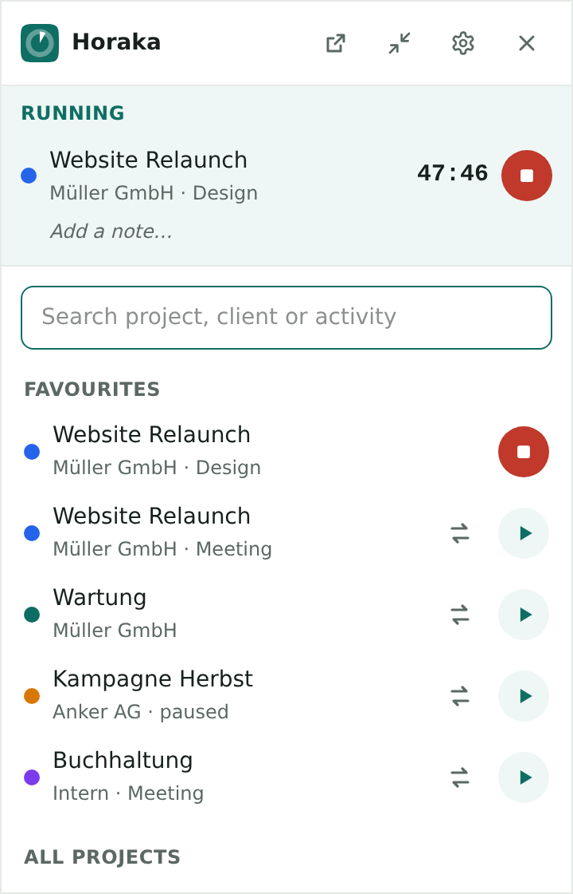
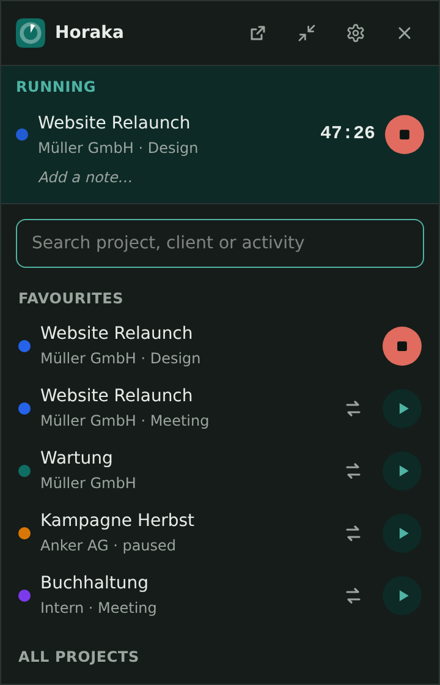
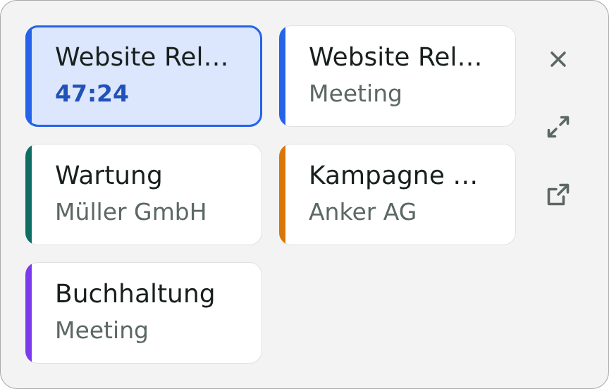
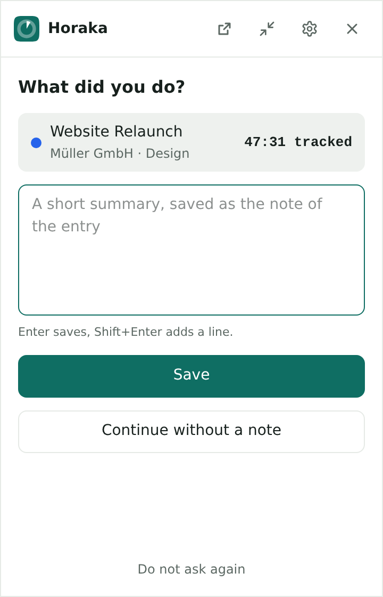
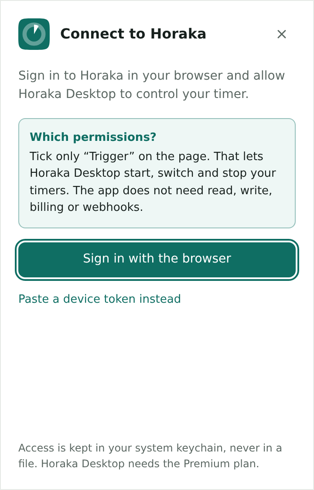
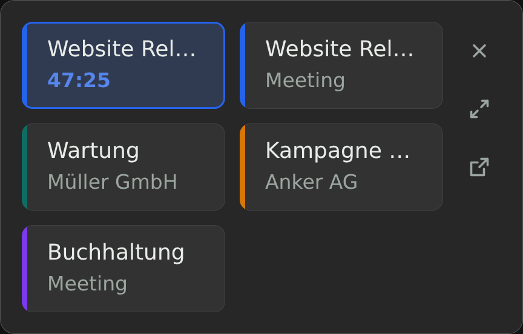
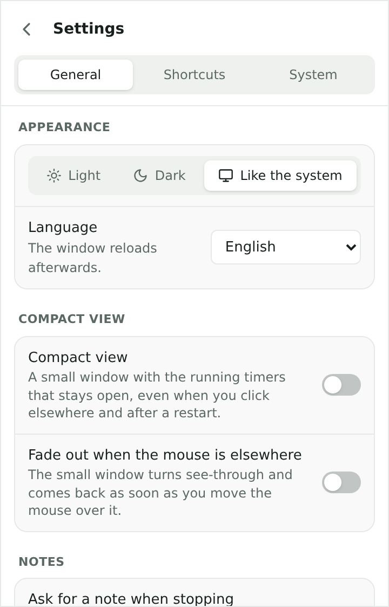
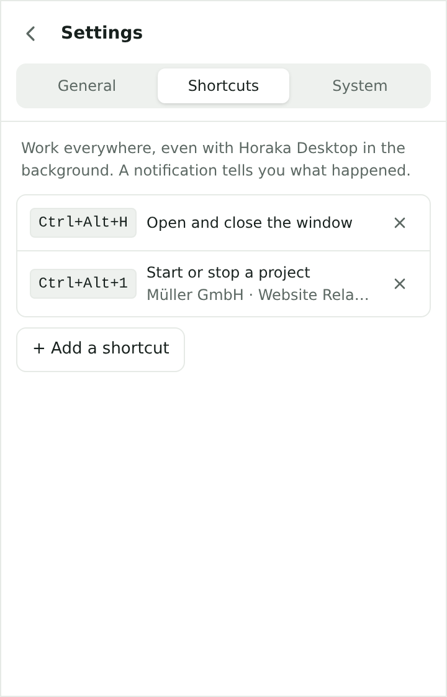

# Horaka Desktop

Horaka Desktop puts your [Horaka](https://www.horaka.com) timer in the Windows notification area and the macOS menu bar. You can pick a project, start a timer, switch and stop without opening the web app. The app talks to Horaka only through the REST API (`https://api.horaka.com/v1`, trigger endpoints) and needs the Premium plan.

<p>
  
  
  
</p>

## Download

Get the latest version from [Releases](https://github.com/s1nn3r/horaka-desktop/releases/latest): `setup.exe` for Windows (x64), `.dmg` for macOS (Apple Silicon and Intel). Setup instructions are on [horaka.com](https://www.horaka.com).

The macOS build is signed ad hoc and not notarised, so Gatekeeper blocks it the first time you open it. Go to System Settings, Privacy & Security and click "Open Anyway" once. After an update, macOS may ask once more for access to the keychain.

## Features

### Tray icon

- The icon shows whether a timer is running. The tooltip shows "Client · Project" and the elapsed time, and on macOS the time also sits next to the icon.
- Left click opens the window. Right click opens a menu (with icons on Windows) with your favourites to start, "Stop all timers", the window, the settings and Horaka in the browser.

### Main window

- Running timers with a live duration and a note field. Enter saves the note, Shift+Enter adds a line, Esc cancels.
- Search across client, project and activity, then favourites, recently used and all projects with their activities.
- If parallel timers are turned on in your Horaka account, each project offers "Start in addition" and "Switch to this".
- When you stop a timer, the window asks "What did you do?" and saves your answer as the note of the entry. This also happens after a stop from a shortcut or the tray menu, and you can turn it off.
- The window opens at the icon and closes when you click elsewhere. Drag it by the header and it stays where you put it, even across restarts. If you unplug a monitor, the window moves to another screen and goes back to its own screen when the monitor returns.

<p>
  
  
</p>

### Compact view

A small window in the style of Windows 11 (grey background, light cards with a colour stripe, no title bar) that stays on top and stays open, also after a restart. Every favourite is a tile: click it to start or stop, and a running tile is tinted and outlined in the project colour and shows its duration. Running timers without a tile appear as a line above the tiles. A slim column on the right has close, full view and Horaka in the browser; drag the window by its grey edge. Drag the right edge to change the width in whole columns (1 to 5, also with the arrow keys), and the rows follow.

The compact view can fade out while the mouse is elsewhere and come back when you hover over it. A slider sets the opacity while faded (10 to 90 percent), and the window previews it while you drag.



### Keyboard shortcuts

Global shortcuts work while Horaka Desktop is in the background. You can assign them to these actions: open and close the window, add a note to the running timer, stop all timers, start or stop a project, and switch to a project. The default is Ctrl+Alt+H (macOS ⌃⌥H) for the window. A system notification tells you what a shortcut or a tray menu item did. If another program already holds a key combination, the settings list the ones the system refused.

### Settings

Three tabs with grouped switches: General, Shortcuts and System.

- Appearance: light, dark or like the system
- Language: English, German, French, Spanish, Italian, Dutch, Polish or Portuguese, or like the system
- Compact view, fading and opacity
- Note when stopping
- Keyboard shortcuts
- Updates: checks at start and every 6 hours (you can turn this off), or on request
- Start when you sign in to your computer
- Window position: back to opening at the icon
- Disconnect

<p>
  
  
</p>

### Sync and updates

The app fetches running timers every 30 seconds and the list of projects every 5 minutes. Without a network connection it waits and carries on by itself when the connection is back.

When a new version is out, the app sends a notification. "Update now" installs it without the installer asking questions and restarts the app.

## Sign in

1. Browser (OAuth 2.1): the app registers with `app.horaka.com` as a public client, opens the consent page in your browser and receives the code on `http://127.0.0.1:<random port>/callback` (RFC 8252, PKCE S256, scope `track`). On the consent page, tick only "Trigger". The access token is valid for one hour and is renewed with a rotating refresh token.
2. Device token: in Horaka, go to Settings, API and devices, add a device of the kind "Horaka Desktop" and paste its token into the app.

Settings are stored in `einstellungen.json` and the window position in `fenster.json`, both in the app's configuration folder. The credentials are stored as JSON in the system keychain (Windows Credential Manager, macOS Keychain) and never in a file. "Disconnect" deletes them and revokes the refresh token.

## Development

Built with [Tauri 2](https://tauri.app) (Rust) and Vue 3 with TypeScript and Tailwind 4. Colours and the logo were copied once from Horaka (`resources/css/tokens.css`, `resources/pwa/zeichen.svg`).

Requirements: Node 24, Rust (stable) and the [Tauri prerequisites](https://tauri.app/start/prerequisites/) for your system.

```bash
npm ci
npm run tauri dev        # app with hot reload
npm run dev              # only the UI in the browser: http://localhost:1420/?vorschau
                         # (sample data; ?vorschau=leer shows the sign-in,
                         # ?vorschau=offline no network, ?vorschau=update the update notice)
npm run types:check
cargo test --manifest-path src-tauri/Cargo.toml
```

To use another instance, set `HORAKA_API_URL` (default `https://api.horaka.com/v1`) and `HORAKA_APP_URL` (default `https://app.horaka.com`).

To regenerate the icons, replace `assets/app-icon.png` (1024 px, made from the logo) and run `npm run icons`. The tray icons are in `src-tauri/icons/tray` (black template images for macOS, coloured for Windows), with their sources in `assets/tray-*.svg`. The screenshots in `docs/screenshots` come from the browser preview at 360 × 560 px and 2x, the compact view with 2 columns (288 px wide) and 3x.

## Build and release

`.github/workflows/bauen.yml` builds every push to `main` for Windows (x64, `setup.exe` in English and German, no MSI) and macOS (universal `.dmg`) and keeps the installers as artifacts. A `v*` tag also creates a draft release.

- Windows builds are signed with Azure Artifact Signing once these repository secrets exist: `AZURE_CLIENT_ID`, `AZURE_CLIENT_SECRET`, `AZURE_TENANT_ID`, `AZURE_SIGNING_ENDPOINT` (for example `https://weu.codesigning.azure.net`), `AZURE_SIGNING_ACCOUNT`, `AZURE_SIGNING_PROFILE`.
- macOS builds are signed ad hoc only, since there is no Apple Developer account.
- The workflow signs updates with the updater key (secrets `TAURI_SIGNING_PRIVATE_KEY` and `TAURI_SIGNING_PRIVATE_KEY_PASSWORD`; the public key is in `tauri.conf.json`). Every release carries `latest.json`, the `.sig` files and `…universal.app.tar.gz` for macOS updates. Never delete these files from a release. If the key is lost, existing installations stop accepting updates.

To release, raise the version in `package.json`, `src-tauri/Cargo.toml` and `src-tauri/tauri.conf.json`, push a `vX.Y.Z` tag and publish the draft release. The apps only see a new version once the release is published, because they read `releases/latest/download/latest.json`.
